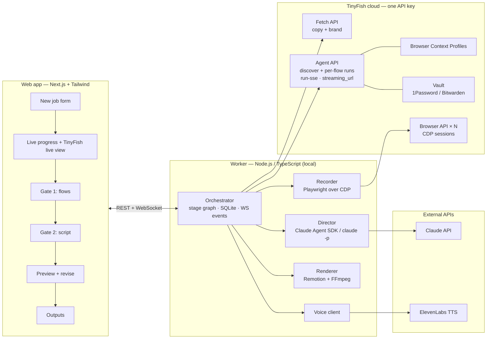
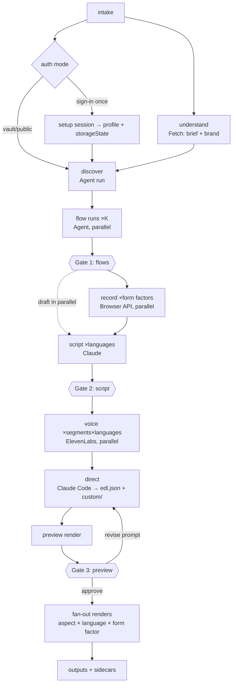

# AgentCast — Product Requirements Document

> **Paste a URL, get a polished launch video of your real product.**
> TinyFish is the camera crew · Claude Code is the director · Remotion is the editing suite.

| | |
|---|---|
| **Status** | Draft v1.0 (hackathon build) |
| **Event** | AzinHacks 2026 · USAR, GGSIPU · TinyFish-sponsored track |
| **Owner** | Kaustav Bhalla |
| **Last updated** | 2026-10-17 |
| **Companion doc** | [`IMPLEMENTATION_PLAN.md`](./IMPLEMENTATION_PLAN.md) |

---

## 0. TL;DR

AgentCast turns a product URL (plus optional test credentials and a style prompt) into a finished, narrated, captioned, music-backed demo video, in several formats and languages, **without a human driving the product or touching an editor**.

1. **Explore:** TinyFish **Agent API** web agents sign in, work through onboarding, and propose the 3–4 flows that best show the product's value. Several run in parallel, one per candidate flow. TinyFish **Fetch API** pulls page copy and brand assets.
2. **Review gate:** a human approves, reorders or edits the flows.
3. **Record:** each approved flow is replayed **deterministically** by our Playwright recorder inside TinyFish **Browser API** cloud browsers over CDP. There is one browser per form factor, all in parallel. CDP screencast frames and a millisecond-accurate action log (`timeline.json`) are captured.
4. **Script:** Claude writes narration per segment from the action log and page copy, natively in each target language. A second review gate follows.
5. **Voice:** ElevenLabs produces one clip per segment per language, with word-level timestamps.
6. **Direct:** Claude Code (headless, sandboxed) writes an **Edit Decision List** (EDL) against our Remotion primitives library. It can also write bespoke components such as intros, callouts and transitions, which are type-checked and test-rendered before use.
7. **Render and fan out:** Remotion renders a fast preview first, then every variant in parallel (16:9 / 9:16 × EN / HI × desktop / mobile), with smart zoom, a synthetic smooth cursor, captions, voiceover, ducked music and a branded intro/outro.
8. **Re-run on update:** cached flows and locators let you regenerate in minutes from the UI, CLI or a GitHub Action.

---

## 1. Problem

Every product needs a demo video for launches, landing pages, investor pitches, app stores, onboarding and hackathon submissions. Making one today means:

| Pain | Today | Consequence |
|---|---|---|
| **Manual recording** | Set up test accounts, script a flow, record, retake every misclick | Hours per video. Founders procrastinate. |
| **Manual editing** | Zooms, cursor smoothing, captions, VO, music by hand in Screen Studio / Premiere / CapCut | Needs editing skill. Quality varies wildly. |
| **One video per variant** | 16:9 vs 9:16, desktop vs mobile, EN vs HI each need a re-record or re-edit | Teams ship one variant, usually English 16:9 only. |
| **Instant decay** | Every UI change outdates the video | Most teams ship stale demos or none at all. |

**Why existing tools fail:**
- Screen recorders and editors still need a human driving the product.
- AI video generators (text-to-video, restyling) produce *footage, not proof*. They can't show the real product.
- No tool opens a live web app, logs in, finds the key flows and records them by itself.

**The gap:** turning a URL into a real, polished product video needs an agent that can actually *use* the product on the live web, with logins, at scale, in parallel. TinyFish is built for exactly this.

---

## 2. Goals and non-goals

### 2.1 Goals (hackathon scope)
- **G1. URL → video, unattended.** From a URL alone (public product) or a URL plus sign-in (gated product), produce a ≥45 s narrated video with no manual recording or editing.
- **G2. Real footage only.** Every on-screen product pixel comes from a real browser session on the live product. Generated graphics are limited to overlays (titles, captions, callouts, cursor).
- **G3. Broadcast-quality edit.** Smart zoom on interactions, smooth cursor, word-synced captions, VO, ducked music, branded intro/outro. A viewer shouldn't be able to tell it was automated.
- **G4. Parallel variants from one run.** At least 16:9 + 9:16 and EN + HI from a single job.
- **G5. Human in the loop.** Review gates for flows and script, plus a revise-by-prompt loop on the preview.
- **G6. Re-run on update.** Regenerating a previously produced video, with the UI changed, takes ≤ 5 min and no human input.
- **G7. Deep, visible TinyFish usage.** Agent, Browser, Fetch, Vault and Browser Context Profiles are each load-bearing, and the live agent view is shown in the UI.

### 2.2 Non-goals (for now)
- Native mobile apps (iOS/Android binaries). Web only; "mobile" means mobile-viewport web.
- Generating fake UI or AI B-roll of the product.
- Solving CAPTCHAs, OTP/2FA or email verification automatically. We detect these and hand off to a human sign-in.
- A multi-tenant SaaS with billing. The hackathon build is single-user, laptop-hosted.
- A full timeline editor UI. Edits happen through the review gates and prompts, not a drag-and-drop NLE.
- Translating the product's UI. The Hindi variant means Hindi narration and captions over the real UI. If the product itself supports `hi` locale, we switch it (P2).

---

## 3. Users and use cases

### 3.1 Personas
| Persona | Need | Primary entry point |
|---|---|---|
| **Indie founder / student builder** | Launch or submission video today, zero editing skill | Web app: paste URL |
| **Product/growth team** | Always-current demos on the site, many formats | CI/CD (GitHub Action) |
| **Support / docs team** | "How to do X" clips per feature, refreshed on UI change | Web app "Tutorial mode", CI |
| **Sales / founder pitching** | Walkthrough tailored to a prospect's interests | Web app with a focus prompt |
| **Civic-tech / NGO** | Hindi step-by-step guides to confusing public portals | Web app, public flows, Hindi-first |

### 3.2 Use cases → feature mapping
| Use case | Key features exercised |
|---|---|
| Product launch videos (Product Hunt, X, landing page) | Explore, launch-style pacing, brand kit intro/outro, 16:9 + 9:16 |
| Always-current demos | Re-run on update, cached replay plans, CLI + GitHub Action, change detection |
| Help-center tutorials | Tutorial mode (one video per flow, step numbering, slower pacing, chapters), SRT export |
| Multilingual marketing | Language fan-out, native-language scripts, Devanagari captions |
| Sales and investor demos | Focus prompt ("emphasize analytics + SSO"), flow selection at gate 1 |
| Hackathon submissions | Fast path: public URL → 60–90 s video, defaults everywhere |
| Public-service walkthroughs | Hindi-first, tutorial mode, public (no-login) flows, slower narration |

---

## 4. Product principles
1. **Footage is proof.** Never synthesize product UI. Overlays may annotate, never fabricate.
2. **Explore with an agent, record with a script.** Agents are great at discovery and bad at clean takes. Discovery is non-deterministic; recording must be deterministic and replayable.
3. **Voice leads, picture follows.** Narration duration drives segment timing. Video is retimed (dead time compressed, holds extended) to fit each language's voice, so we record once and narrate many times.
4. **Data contracts over prompts.** Every stage emits a versioned, schema-validated JSON artifact. LLMs write *data and small components*, and deterministic code turns data into pixels.
5. **Every stage is resumable and cacheable.** Artifacts are content-addressed, so a re-run skips everything whose inputs didn't change.
6. **Secrets never reach an LLM.** Credentials go from Vault or the local encrypted store straight into the browser. Not into prompts, logs, captions or footage.

---

## 5. User experience

### 5.1 Primary flow (web app)
```
[1] New video
    URL ............ https://your.app
    Sign-in ........ ( ) Public   (•) Sign in once   ( ) Use TinyFish Vault
    Style prompt ... "Upbeat, 60s, for Product Hunt, focus on the AI editor"
    Variants ....... [x] 16:9  [x] 9:16   [x] English  [x] Hindi   [ ] Mobile web
    Mode ........... (•) Launch video  ( ) Tutorial (one per flow)  ( ) Sales demo
                                                         [ Generate → ]

[2] Exploring…   ┌──────── live TinyFish agent view (iframe) ────────┐
                 │  agent 1: "Sign in and finish onboarding"          │
                 │  agent 2: "Create a project from a template"   ... │
                 └────────────────────────────────────────────────────┘
    Stage rail:  ● Explore  ○ Review flows  ○ Record  ○ Script  ○ Voice  ○ Direct  ○ Render

[3] GATE 1 — Review flows
    ☑ 1. Create a project from a template   (6 steps, ~14s)   [edit steps] [▲▼]
    ☑ 2. Ask the AI editor to rewrite a section (5 steps)
    ☐ 3. Invite a teammate                   (needs real email: skipped by default)
    ☑ 4. Export to PDF
    [ + Describe another flow ]                                  [ Approve & record ]

[4] Recording…  4 cloud browsers, live thumbnails, per-step ticks ✓

[5] GATE 2 — Review script (per segment, per language, with screenshot of that moment)
    seg 1 (EN, ≤6.0s) "Start from a template. One click and your workspace is ready."
    seg 1 (HI, ≤6.0s) "टेम्पलेट से शुरू करें — एक क्लिक में आपका वर्कस्पेस तैयार।"
                                                   [ regenerate ] [ Approve script ]

[6] Preview (540p, 16:9 EN)   ▶  ───────────────
    Revise: "Make the intro shorter and zoom harder on the AI panel"  [ Send ]
                                                   [ Approve & render all variants ]

[7] Outputs: 16:9 EN · 16:9 HI · 9:16 EN · 9:16 HI   ⤓ MP4 · ⤓ SRT/VTT · ⤓ thumbnail · ⤓ GIF
             [ Re-run on latest UI ]  [ Copy CI snippet ]
```

**Gate defaults.** "Autopilot" (toggle) skips gates 1 and 2 with auto-approval. This is used by CI and by the hackathon fast path.

### 5.2 Sign-in UX ("sign in once")
For gated products, the user signs in **themselves** in a remote TinyFish browser shown in our UI. That covers SSO, OTP and CAPTCHA, since a human handles them. We save the session to a **TinyFish Browser Context Profile** (used by explore agents) and capture an encrypted local `storageState` (used by the recorder). See §8.2.

### 5.3 CLI / CI
```bash
npx agentcast run --url https://your.app --profile prof_abc --variants 16x9:en,9x16:hi --autopilot
npx agentcast rerun --job job_7f3a          # reuse approved flows + script, re-record, re-render
```
```yaml
# .github/workflows/demo-video.yml  (P1)
on: { release: { types: [published] } }
jobs:
  demo:
    runs-on: ubuntu-latest
    steps:
      - uses: agentcast/rerun-action@v0
        with: { job-config: agentcast.yml, tinyfish-key: ${{ secrets.TINYFISH_API_KEY }} }
```

---

## 6. Functional requirements

Priority: **P0** = required for the hackathon demo · **P1** = should have, builds the story · **P2** = stretch / roadmap.

### 6.1 Job intake
| ID | Requirement | Pri |
|---|---|---|
| FR-1 | Accept URL, auth mode (public / sign-in-once / vault), style prompt, mode, variant matrix | P0 |
| FR-2 | Validate URL (http/https, public host; reject private IPs, localhost, metadata endpoints for SSRF safety) | P0 |
| FR-3 | Optional focus prompt ("show analytics and SSO") that biases flow discovery | P1 |
| FR-4 | Persist job config as `job.json`. Jobs are resumable after a crash or restart. | P0 |

### 6.2 Product understanding (TinyFish Fetch)
| ID | Requirement | Pri |
|---|---|---|
| FR-10 | Fetch landing page + up to 9 discovered key pages (pricing, features, docs) as markdown in one Fetch API batch | P0 |
| FR-11 | Produce `product-brief.json`: name, one-liner, value props, audience, tone, key terms | P0 |
| FR-12 | Extract **brand kit**: logo (favicon / og:image / header img), primary and accent colors, font family hints | P1 |
| FR-13 | Search API for third-party context (what users praise) feeding the script | P2 |

### 6.3 Explore (TinyFish Agent)
| ID | Requirement | Pri |
|---|---|---|
| FR-20 | Discovery run: agent signs in (profile or vault), completes onboarding, maps the product, proposes 4–6 candidate flows with a value rationale | P0 |
| FR-21 | Flow runs: one Agent run **per candidate flow in parallel**, which executes the flow and returns a structured step list with **semantic targets** (visible text, ARIA role, label, placeholder, nearby text), values, expected outcome and a narration hint | P0 |
| FR-22 | Stream the TinyFish live view (`streaming_url`) of each agent into the UI | P0 |
| FR-23 | Guardrails in every goal: stay on the product's domain, no destructive or irreversible actions (delete, pay, send to real users, change billing), no real personal data | P0 |
| FR-24 | Detect blockers (CAPTCHA, OTP, email verification, paywall) and surface a "sign in once" or skip prompt instead of failing silently | P1 |
| FR-25 | Score and rank flows (value shown, steps, risk, duration) and pre-select top 3–4 | P1 |
| FR-26 | User can add a flow in natural language at gate 1, which spawns one more flow run | P1 |
| FR-27 | Seed demo data: the agent fills the account with realistic sample content before recording, so screens look lived-in | P2 |

### 6.4 Gate 1: flow review
| ID | Requirement | Pri |
|---|---|---|
| FR-30 | List flows with per-step screenshots (from TinyFish step screenshots), estimated duration, toggle, reorder, rename | P0 |
| FR-31 | Edit a step's target text or typed value inline | P1 |
| FR-32 | Autopilot auto-approves the top-ranked flows | P0 |

### 6.5 Record (TinyFish Browser + Playwright over CDP)
| ID | Requirement | Pri |
|---|---|---|
| FR-40 | One TinyFish Browser API session per (form factor), sessions in parallel. Each replays all approved flows in order. | P0 |
| FR-41 | Restore auth by injecting captured `storageState`, or replay the login steps with locally-held credentials (never sent to an LLM) | P0 |
| FR-42 | Resolve each semantic target to a Playwright locator via a fallback chain (role+name → label → placeholder → text → LLM pick from ARIA snapshot). Cache resolved locators in `replay-plan.json`. | P0 |
| FR-43 | Human-like action execution: eased mouse path to the element's bbox center, hover dwell, click, per-character typing with jitter, smooth scrolling | P0 |
| FR-44 | Capture CDP `Page.startScreencast` frames with timestamps. Transcode to constant-frame-rate MP4. | P0 |
| FR-45 | Emit `timeline.json`: for every action, `t`, kind, label, bbox, cursor path, URL, settle time, and **dead intervals** (locator resolution, slow loads) safe to cut | P0 |
| FR-46 | "Takes": if a step fails, the take is discarded and retried (max 3), self-healing the failing locator. Only clean takes are kept. | P0 |
| FR-47 | Desktop (1440×900 @2x) and mobile (390×844 @3x, touch, mobile UA) form factors | P0 desktop / P1 mobile |
| FR-48 | PII redaction: blur DOM elements matching email, API-key or token patterns and user-specified selectors via injected CSS before capture | P1 |
| FR-49 | Fallback footage: if CDP recording fails entirely, use the Agent run's `video_url` recording for that flow, marked as "rough" | P2 |

### 6.6 Script (Claude)
| ID | Requirement | Pri |
|---|---|---|
| FR-50 | Write narration per segment from `timeline.json`, `product-brief.json`, flows and style prompt. Each segment gets a **word/second budget** from its visual duration. | P0 |
| FR-51 | Write each language natively, not as a literal translation. Hindi uses natural Hindustani with common English tech terms kept in Latin script where they're the idiomatic choice ("dashboard", "template"). | P0 |
| FR-52 | Title card text, hook line (first 3 s), CTA line, video title + description for posting | P0 |
| FR-53 | Gate 2: per-segment edit / regenerate, side by side with that segment's frame | P0 |
| FR-54 | Tutorial mode: imperative step-by-step voice ("Step 2: click **New project**") | P1 |

### 6.7 Voice (ElevenLabs)
| ID | Requirement | Pri |
|---|---|---|
| FR-60 | One TTS clip per segment per language using the `with-timestamps` endpoint. Store audio + character alignment. | P0 |
| FR-61 | Voice presets per language and tone, selected by the director from the style prompt | P1 |
| FR-62 | Auto-tighten: if a clip exceeds its segment budget by >25%, ask Claude to shorten that line and re-synthesize once | P1 |

### 6.8 Direct (Claude Code, headless)
| ID | Requirement | Pri |
|---|---|---|
| FR-70 | Claude Code runs in a per-job sandboxed workspace containing the Remotion project, primitives library, all artifacts and a `DIRECTOR.md` brief | P0 |
| FR-71 | Output: `edl.json` (validated against the zod schema). It covers segment order, in/out points, speed ramps, camera keyframes (zoom targets), callouts, transitions, music mood, intro/outro design. | P0 |
| FR-72 | Optional bespoke components in `custom/` (intro, outro, callout styles). Each must pass `tsc --noEmit` and a `remotion still` test render, or the director falls back to the default primitive. | P1 |
| FR-73 | Revise loop: free-text feedback on the preview → Claude edits EDL/components → re-preview | P0 |
| FR-74 | Different style prompts produce visibly different edits (pacing, palette, transitions, typography). Running twice with the same inputs shouldn't produce a bland template look. | P1 |

### 6.9 Render and fan-out (Remotion + FFmpeg)
| ID | Requirement | Pri |
|---|---|---|
| FR-80 | Preview render: 960×540 (or 540×960), 30 fps, fast encoding, target ≤ 60 s wall time for a 60 s video | P0 |
| FR-81 | Final renders: 1920×1080 and 1080×1920 H.264 MP4, AAC, -14 LUFS loudness, all approved variants in parallel | P0 |
| FR-82 | **Virtual camera**: smart zoom and 9:16 reframing are the same primitive, a smoothed crop window following camera keyframes, clamped to frame | P0 |
| FR-83 | Synthetic cursor rendered from `timeline.json` cursor paths (headless screencast has no cursor), with click ripple, eased motion and a hide-when-idle option | P0 |
| FR-84 | Word-level captions from TTS alignment, styled per EDL. Noto Sans Devanagari for Hindi. | P0 |
| FR-85 | Music from a local royalty-free library tagged by mood/BPM, ducked under VO (−18 dB, 200 ms attack/release), fade in/out | P0 |
| FR-86 | Sidecar exports: SRT/VTT per language, poster thumbnail, 6 s GIF teaser, chapters (tutorial mode) | P1 |

### 6.10 Re-run on update
| ID | Requirement | Pri |
|---|---|---|
| FR-90 | Re-run reuses approved flows, replay plan, script and EDL. It re-records only, self-heals broken locators, re-voices only segments whose script changed, and re-renders. | P0 |
| FR-91 | Change detection: perceptual-hash key frames vs the last run. Report "UI changed in flows 2, 4" and skip render if nothing changed (CI mode). | P1 |
| FR-92 | If a flow can't self-heal, re-run that flow's TinyFish Agent exploration only, then continue | P1 |
| FR-93 | CLI (`agentcast run/rerun`) and GitHub Action wrapper | P1 |
| FR-94 | Webhook mode: TinyFish `webhook_url` for async agent runs (needed when the worker is behind a public URL) | P2 |

---

## 7. System architecture

### 7.1 What changed from the original sketch, and why

| # | Original idea | Revised | Why |
|---|---|---|---|
| 1 | TinyAgent emits `flow.json` with **selectors** | Agent emits **semantic targets** (text/role/label). Our recorder resolves them to locators at record time and caches them. | TinyFish Agent run steps are natural-language action descriptions + screenshots, with no selectors in the documented step schema. Semantic targets also survive UI changes better than CSS selectors, which is what makes "re-run on update" work. |
| 2 | TinyProfiles feed both explore and record | Profile feeds **explore**. A locally captured `storageState` (taken during the same sign-in session) feeds **record**. | Browser Context Profiles attach to Agent API runs. Direct Browser API sessions are documented as isolated with no profile parameter. One human sign-in should serve both. |
| 3 | Record × N: one browser per (form factor × language) | One browser per **form factor**. Language is a narration concern. | The product UI doesn't change with narration language. Recording per language doubles cost and creates inconsistent takes. We retime footage per language instead (§9.6). |
| 4 | Claude writes a **fresh Remotion composition every run, no template** | Claude writes an **EDL** against a tested **primitives library**, plus optional bespoke components that are compiled and test-rendered with fallback | Freeform TSX per run is the biggest reliability risk: compile errors, render crashes, multi-minute fix loops. The EDL keeps Claude creative (pacing, camera, typography, custom intros) and makes variant fan-out, revisions and re-runs cheap. |
| 5 | Single approval gate before render | Three gates: flows → script → preview with revise loop. Autopilot skips all three. | Cheapest to fix mistakes early. Recording a wrong flow wastes the most time. |
| 6 | Cursor smoothing implied | **Synthetic cursor** composited in Remotion from logged mouse paths | Headless CDP screencast doesn't render the OS cursor at all. |
| 7 | Orchestrator is a job pipeline | **Resumable stage graph** with content-addressed artifacts | Enables crash recovery, re-run on update and CI with minimal recompute. |
| 8 | — | **Fetch-based brand kit + product brief** | Free under TinyFish Fetch's daily allowance, and makes the intro/outro look on-brand automatically. |

### 7.2 Component diagram



### 7.3 Pipeline (stage graph)



Each node is a **stage** with declared inputs and outputs. Its cache key is `sha256(stage version + input artifact hashes + relevant config)`. A stage is skipped when its key matches a completed run, which is how re-run on update stays cheap.

### 7.4 Runtime topology (hackathon)
- **`apps/web`**: Next.js (App Router) + Tailwind. Talks to the worker over REST + a WebSocket for events.
- **`apps/worker`**: a long-lived Node process (Fastify). Owns the orchestrator, SQLite (`better-sqlite3`) for job/stage state, the filesystem job store (`~/.agentcast/jobs/<jobId>/`), Playwright, Remotion bundling and rendering, and Claude invocations. Rendering never runs inside Next.js route handlers.
- Concurrency limits (configurable): Agent runs 4, Browser sessions 4, TTS 6, renders 2 (CPU-bound).

---

## 8. TinyFish integration (sponsor surface)

| Product name in deck | TinyFish API | Used for | Key params |
|---|---|---|---|
| **TinyFetch** | Fetch API `POST api.fetch.tinyfish.ai` | Product copy, brand kit, link discovery | `urls[≤10]`, `format: "markdown"`, `links: true`, `image_links: true` |
| **TinyAgent** | Agent API `/v1/automation/run-sse`, `/run-async` (+ batch) | Discovery + per-flow exploration in parallel | `url`, `goal`, `output_schema`, `browser_profile: lite\|stealth`, `use_profile`, `profile_id`, `use_vault`, `credential_item_ids`, `agent_config.max_steps` |
| *(live view)* | `STREAMING_URL` SSE event | Live agent iframes in the UI | — |
| *(step evidence)* | `GET /v1/runs/{id}?screenshots=url` | Gate-1 step thumbnails, fallback `video_url` | — |
| **TinyProfiles** | Browser Context Profiles `/v1/profiles`, setup session, save | Sign in once, reused by all explore runs | `POST /v1/profiles/{id}/setup-session` → `cdp_url` |
| **TinyVault** | Vault (1Password / Bitwarden) | Agent logs in without the LLM seeing passwords | `use_vault: true`, `credential_item_ids` |
| **TinyBrowser** | Browser API `POST api.browser.tinyfish.ai` | Deterministic recording over CDP, one per form factor, parallel | `url`, `timeout_seconds`, `proxy_config` → returns `session_id`, `cdp_url`, `base_url` |
| *(optional)* | Search API | Third-party product context for the script | P2 |

All calls use the `X-API-Key` header and are made **only from the worker**. The API key never reaches the browser. `streaming_url` values are safe to send to the client.

### 8.1 Explore: goal and output schema (sketch)

Discovery run goal (abridged):
```
You are evaluating {product} for a product demo video. {focus prompt if any}
1. If not signed in, sign in using the available credentials. Complete any onboarding with sensible sample values.
2. Explore the main navigation. Identify 4–6 user flows that best demonstrate the product's core value in under 20 seconds each.
3. Prefer flows that create something visible (a project, a chart, a generated output). Avoid settings pages.
RULES: Stay on {domain}. Never delete data, make payments, change billing, send invites/emails to real people, or submit personal information.
Return JSON matching the schema.
```

Per-flow run output schema (validated in Spike S2, see the implementation plan):
```json
{
  "type": "object",
  "properties": {
    "flow_title": { "type": "string" },
    "completed": { "type": "boolean" },
    "start_url": { "type": "string" },
    "steps": {
      "type": "array",
      "items": {
        "type": "object",
        "properties": {
          "action": { "type": "string", "enum": ["navigate","click","type","select","press","scroll","hover","wait"] },
          "target_text": { "type": "string" },
          "target_role": { "type": "string" },
          "target_label": { "type": "string" },
          "near_text": { "type": "string" },
          "value": { "type": "string" },
          "expected_result": { "type": "string" },
          "narration_hint": { "type": "string" }
        },
        "required": ["action"]
      }
    },
    "value_shown": { "type": "string" },
    "blockers": { "type": "array", "items": { "type": "string" } }
  },
  "required": ["flow_title", "completed", "steps"]
}
```

### 8.2 Auth strategy
| Mode | Explore (Agent API) | Record (Browser API) | Secrets reach an LLM? |
|---|---|---|---|
| **Public** | no auth | no auth | n/a |
| **Sign in once** (default for gated apps) | `use_profile: true, profile_id` | Our Playwright connects to the *same* setup session's `cdp_url` before save and exports `context.storageState()` to the encrypted local store. The recorder injects cookies + localStorage. | **No.** The human types credentials. |
| **TinyFish Vault** | `use_vault: true, credential_item_ids` | The recorder replays the login steps with credentials from the local encrypted store (user-provided), typed directly via Playwright | **No.** TinyFish keeps values out of the agent; we never put them in prompts. |
| **Raw test credentials** | Put into a Vault item (recommended) or used to create a profile via a scripted login | Same as above | **No.** Never placed into `goal`. |

Typed values marked `secret` are stored as `{"redacted": true}` in `timeline.json`. Captions, narration and Claude never see them.

---

## 9. Pipeline deep dive

### 9.1 Understand (Fetch)
1. Fetch the root URL with `links: true, image_links: true`.
2. Pick up to 9 same-origin links scored by path keywords (`/features`, `/pricing`, `/product`, `/docs`, `/about`), and fetch them in one batch.
3. Claude (small model) produces `product-brief.json`. A deterministic extractor produces `brand.json`: logo candidates from `image_links`, colors from a quick headless screenshot palette (k-means on the hero) or `theme-color` meta.

### 9.2 Discover and flow runs (Agent)
- The discovery run uses `/run-sse` so we can stream `PROGRESS.purpose` lines and `STREAMING_URL` to the UI.
- Candidate flows each get their own `/run-async` run (batch endpoint), polled via `GET /v1/runs/{id}`, also live-viewable.
- Results are normalized into `flows.json`. Step screenshots are pulled for gate 1.
- **Why two levels:** a single long agent run that "finds and performs 4 flows" is slow, serial and fails as one unit. Per-flow runs parallelize and fail independently.

### 9.3 Record (Browser API + Playwright)
Per form factor:
1. `POST api.browser.tinyfish.ai` → `cdp_url`. `chromium.connectOverCDP(cdp_url)`.
2. Create a context with the form factor's viewport, DPR, UA, touch. Inject `storageState`. (Spike S1 verifies `newContext` over TinyFish CDP; fallback is `Emulation.setDeviceMetricsOverride` on the default context.)
3. Inject recording CSS: hide scrollbars, disable caret blink, blur redaction selectors, `prefers-reduced-motion: no-preference`.
4. `Page.startScreencast({format:'jpeg', quality:85, maxWidth, maxHeight})`. Frames are acked; each frame is stored with `metadata.timestamp`.
5. For each flow, then each step:
   - Mark `t_resolve_start`.
   - Resolve the locator (cache first, then the fallback chain).
   - Mark a dead interval `[t_resolve_start, t_resolved]`.
   - Get `boundingBox()`.
   - Animate the mouse along an eased path (~350–600 ms, distance-scaled).
   - Hover dwell 150 ms, then act.
   - Wait for settle (network idle ≤ 2 s or DOM-stable 300 ms). Mark slow-load portions as dead.
   - Log the event.
6. Stop the screencast. Frames + timestamps go through ffmpeg (concat demuxer with per-frame durations) into CFR 30 fps `recording.mp4`. Write `timeline.json`.
7. `DELETE` the session (always, in `finally`).

**Clock sync:** action times are logged with the local monotonic clock. Offset to screencast clock = median(`receipt_local − metadata.timestamp`) over all frames. Timeline `t` is expressed in video time.

**Take model:** a failed step aborts the take (we don't keep partial footage), heals the locator (LLM pick from `ariaSnapshot()`), and restarts that flow from its `start_url`. Flows are separate sub-clips, so one bad flow doesn't invalidate the others.

### 9.4 Script (Claude)
Input: brief, flows, `timeline.json` (labels, durations, dead time removed), style prompt, mode, language list.
Output: `script.<lang>.json`, one line per segment with `maxSeconds` from compressed visual duration × pacing factor, plus hook, title card, CTA and posting copy.
Speech-rate budgets: EN ≈ 2.6 words/s (launch), 2.2 (tutorial). HI ≈ 2.3 words/s. All are tunable after TTS measurement.

### 9.5 Voice (ElevenLabs)
`POST /v1/text-to-speech/{voice_id}/with-timestamps` with a multilingual model. Response audio → `voice/<lang>/<segmentId>.mp3`, and alignment (character start/end times) → word timings → `captions.<lang>.json`. Clips run in parallel with a bounded pool.

### 9.6 Retiming ("fit video to voice")
For each segment and language:
```
visual_raw   = source out − in (with dead intervals removed)
voice        = clip duration + 0.25 s lead + 0.35 s tail
target       = max(visual_raw / maxSpeed(1.6), voice)
if visual_raw > target: speed-ramp non-interaction spans (typing, loads) up to maxSpeed, never during cursor approach + click
if visual_raw < target: hold on the settled frame with a slow camera drift (Ken Burns) to fill
```
Remotion's `calculateMetadata` computes total duration per (language × aspect) from this, so the same EDL renders correctly for every variant.

### 9.7 Direct (Claude Code)
- The workspace is the job's `render/` dir: a Remotion project with `src/primitives/*` (VirtualCamera, Cursor, ClickRipple, Captions, Callout, TitleCard, LowerThird, Transition, MusicBed), `src/schema/edl.ts` (zod), artifacts in `data/`, and `DIRECTOR.md` (role, rules, style prompt, budget).
- It's invoked through the **Claude Agent SDK** (the engine behind Claude Code), with a `claude -p` CLI fallback. The model is configurable (default: the latest Claude Opus).
- **Allowed tools:** `Read`, `Write`, `Edit`, `Glob`, `Grep`, and `Bash` restricted to `npx tsc --noEmit`, `npx remotion still …`, `node scripts/validate-edl.mjs`. No network tools. `maxTurns` 30, wall-clock timeout 6 min.
- **Definition of done:** `edl.json` validates, `custom/*` type-checks, and three stills (0 s, middle, end) render without error. The worker re-verifies independently, so it doesn't trust the agent's claim.
- **Revise loop:** user feedback is appended to the session, and Claude edits only what is needed.

### 9.8 Render and fan-out
- Bundle once per job (`@remotion/bundler`). `renderMedia` per variant with `inputProps = { lang, aspect, formFactor }`.
- **Virtual camera math:** camera keyframes are in *source* coordinates (`{t, bbox, zoom}`). For each output aspect, the crop rect = the largest rect of that aspect containing `bbox × padding`, scaled by zoom, clamped to the frame, and spring-smoothed (critically damped). For 9:16 from desktop footage, this reframes like a camera operator. Mobile footage at 9:16 is native.
- **Audio:** VO per segment as `<Audio>` in `<Sequence>`s. Music with a volume callback for ducking. Final loudness normalized in an FFmpeg pass.
- **Outputs:** `out/<variant>.mp4`, `.srt`, `.vtt`, `poster.jpg`, `teaser.gif`.

---

## 10. Data contracts

All artifacts live in `~/.agentcast/jobs/<jobId>/` and carry `"schemaVersion"`. Zod schemas live in `packages/shared`.

```ts
// flows.json
type Flow = {
  id: string; title: string; whyItMatters: string; startUrl: string;
  requiresAuth: boolean; rank: number; selected: boolean;
  steps: Step[]; tinyfishRunId: string;
};
type Step = {
  id: string;
  action: 'navigate'|'click'|'type'|'select'|'press'|'scroll'|'hover'|'wait';
  target?: { text?: string; role?: string; label?: string; placeholder?: string; near?: string };
  value?: string; secret?: boolean;
  expected?: string; narrationHint?: string; screenshotUrl?: string;
};

// replay-plan.json — cache of resolved locators per form factor
type ReplayPlan = Record<FormFactor, Record<StepId, { strategy: 'role'|'label'|'placeholder'|'text'|'llm'; locator: string; lastOk: string }>>;

// recordings/<formFactor>/timeline.json  (the edit timeline)
type Timeline = {
  recordingId: string; formFactor: 'desktop'|'mobile';
  viewport: { w: number; h: number; dpr: number }; fps: 30; duration: number;
  flows: { flowId: string; in: number; out: number }[];
  events: TimelineEvent[];
  dead: [number, number][];                 // safe-to-cut intervals
};
type TimelineEvent = {
  t: number; flowId: string; stepId: string;
  kind: Step['action'] | 'settled';
  label: string;                           // "Create project"
  bbox?: [number, number, number, number]; // x, y, w, h in CSS px
  cursor?: { from: [number, number]; to: [number, number]; t0: number; t1: number };
  value?: string | { redacted: true };
  url: string;
};

// script.<lang>.json
type Script = {
  lang: 'en'|'hi'|string; hook: string; titleCard: string; cta: string;
  posting: { title: string; description: string; hashtags: string[] };
  segments: { segmentId: string; flowId: string; text: string; maxSeconds: number }[];
};

// edl.json — written by Claude Code, rendered by Remotion
type EDL = {
  schemaVersion: 1; fps: 30;
  style: { palette: { bg: string; fg: string; accent: string }; font: string;
           pacing: 'calm'|'balanced'|'punchy'; captionStyle: 'karaoke'|'block'|'minimal';
           music: { mood: string; trackId?: string; duckDb: number } };
  intro: { component: string; props: Record<string, unknown>; seconds: number };
  segments: {
    id: string; flowId: string; formFactorSource?: 'desktop'|'mobile';
    in: number; out: number; maxSpeed?: number;
    camera: { t: number; target: 'full' | [number, number, number, number]; zoom: number; ease: 'spring'|'smooth'|'cut' }[];
    cursor: 'auto'|'hidden'; callouts?: { t: number; text: Record<string, string>; anchor: [number, number, number, number] }[];
    transitionIn: 'cut'|'fade'|'slide'|'zoom-through'|string;
  }[];
  outro: { component: string; props: Record<string, unknown>; seconds: number };
};
```

`timeline.json` is the edit timeline. **bbox** drives auto-zoom and callout anchors. **t** drives cuts, captions and cursor motion.

---

## 11. Non-functional requirements

| Area | Target |
|---|---|
| **Latency** (public app, 3 flows, 2 langs, 2 aspects, autopilot) | Understand ≤ 30 s · Explore ≤ 4 min · Record ≤ 2 min · Script+Voice ≤ 1 min · Direct ≤ 3 min · Preview ≤ 1 min · Fan-out ≤ 4 min → **first preview ≤ 10 min, all variants ≤ 14 min** |
| **Re-run on update** | ≤ 5 min to all variants when flows self-heal |
| **Visual quality** | 1080p output. Source frames captured at DPR 2 so 2× zoom stays crisp. Effective source FPS ≥ 20 (spike S1 measures). CFR 30 fps output. |
| **Reliability** | ≥ 80% of runs on the curated demo targets produce a video with no human intervention. Every stage has retries with backoff and honors `Retry-After` on 429/503. |
| **Cost control** | `max_steps` and `max_duration_seconds` on every Agent run. Browser sessions get `timeout_seconds` and guaranteed `DELETE`. TTS only re-synthesizes changed lines. Per-job budget display. |
| **Observability** | Structured logs per stage (pino), every external call logged with duration and status (no secrets), stage timings shown in the UI, `events.ndjson` per job for replay/debug |
| **Portability** | Runs on a single laptop (Linux/macOS), Node 20+, FFmpeg (bundled by Remotion), Chromium only for local stills |

---

## 12. Security, privacy and safety

| Threat | Mitigation |
|---|---|
| **Credential leakage to LLMs/logs** | Vault or a human sign-in. Local secrets are AES-256-GCM encrypted with a key in the OS keychain or an env var. `secret` values redacted in all artifacts. Password fields are already masked on screen, and email/token patterns are blurred (FR-48). |
| **Prompt injection from the target site** | Page copy, step text and screenshots are *untrusted data*. Claude Code runs with no network tools, a restricted Bash allowlist, a job-scoped cwd and no env secrets. Worst case is a bad video, not exfiltration. The EDL is schema-validated, and custom components are type-checked and rendered in Remotion's sandbox. Prompts wrap site content in delimiters with instructions to treat it as data. |
| **Agent doing damage in a real account** | Guardrails in every goal (FR-23). Recommend test accounts or staging. Domain allowlist. The recorder only executes approved steps. Steps whose labels match destructive keywords (`delete`, `remove`, `pay`, `purchase`, `send`, `invite`) need explicit approval at gate 1 even in autopilot. |
| **SSRF via URL intake** | Validate scheme and host, block private/loopback/link-local ranges and metadata IPs. TinyFish Fetch also rejects these. |
| **Third-party content rights** | Users may only generate videos of products they own or are authorized to show. Music library is royalty-free with licenses tracked in `music/LICENSES.md`. |
| **Bot detection / ToS** | Use `browser_profile: "stealth"` only for the user's own product. No CAPTCHA solving. |

---

## 13. Success metrics

### Hackathon judging
- **Live demo:** paste a URL on stage → live agent view → gate 1 → preview video within the slot (with a pre-generated backup run).
- **TinyFish depth:** five TinyFish surfaces load-bearing (Fetch, Agent, Profiles, Vault, Browser), plus live view and parallelism shown visibly.
- **Wow moments:** the same run yields 16:9 EN + 9:16 HI. "Re-run on update" after changing a button label in the demo app live.

### Product
- Time-to-first-video (median) ≤ 10 min. Re-run ≤ 5 min.
- Autopilot success rate on the 10-site benchmark set ≥ 80%.
- Revision rounds per approved video ≤ 1.5.
- Share of renders where the user changed nothing at gates 1–2 (trust signal).

---

## 14. Risks and mitigations

| # | Risk | Likelihood | Impact | Mitigation |
|---|---|---|---|---|
| R1 | CDP screencast over a remote TinyFish session yields a low or uneven frame rate | Med | High | Spike S1 first. Try with the proxy disabled (`proxy_config.enabled:false`) for lower latency, reduce `maxWidth`, use `everyNthFrame`. Fallback: Playwright `recordVideo` via `newContext` over CDP. Last resort: the Agent run `video_url`. Zooms, holds and the synthetic cursor mask a moderate FPS well. |
| R2 | Agent output steps too vague to replay | Med | High | Strict `output_schema` with semantic targets. Prompt for exact visible text. LLM locator healing from ARIA snapshot. Gate-1 inline editing. |
| R3 | `newContext` with custom viewport not permitted on TinyFish CDP | Low-Med | Med | `Emulation.setDeviceMetricsOverride` + `Network.setUserAgentOverride` on the default context. |
| R4 | Profile state can't be exported for the recorder | Known | Med | Capture `storageState` ourselves from the setup session before saving (§8.2). Otherwise replay login. |
| R5 | Claude Code direction slow or produces broken components | Med | Med | EDL-first design with a primitives library, test-render gate, fallback to defaults, time cap |
| R6 | Remotion render time on a laptop for 8 variants | Med | Med | Preview at 540p. Final concurrency tuned. Only render selected variants. Remotion Lambda as a stretch option. |
| R7 | Hindi TTS quality or pronunciation of product names | Med | Low | Multilingual voice, Latin-script product names, pronunciation dictionary / phonetic respelling in the script |
| R8 | Target site blocks automation, or CAPTCHA/OTP | Med | Med | Stealth profile, human sign-in once, curated demo targets for judging |
| R9 | Indian public portals geo-restrict non-Indian IPs. TinyFish proxy countries are US/GB/CA/DE/FR/JP/AU. | Med | Med (civic use case) | `proxy_config.type: "custom"` with an Indian proxy, or demo with portals that don't geo-block |
| R10 | Credit or rate limits during the live demo | Low | High | Pre-warm, cache artifacts, pre-generated backup run, budget display, honor `Retry-After` |
| R11 | Agent creates duplicate data on each re-run (e.g. "Q4 Plan (3)") | High | Low | Templated values with a run suffix hidden by the camera crop, or idempotent names. Optional cleanup flow (P2). |
| R12 | Remotion licensing | Low | Low | Free for individuals and companies ≤ 3 people. Revisit for commercial launch. |

---

## 15. Open questions
1. Is `capture_config` (recording, screenshots) enabled on our TinyFish account? It's account-gated and affects FR-49.
2. Does TinyFish CDP allow `Browser.newContext`, and what are the practical concurrency limits on Browser sessions for our plan?
3. Does a profile setup session started for an existing profile load its saved state? If yes, re-auth refresh for the recorder becomes trivial.
4. Is agent `max_steps` (beta) enabled on our key, or do we rely on `max_duration_seconds` only?
5. Which default voices (EN/HI) do we ship, and are we cleared to use them in public demo videos?
6. Hackathon rules: is pre-event preparation (spikes, primitives library) allowed? This affects phase scheduling.

---

## 16. Roadmap beyond the hackathon
- **More languages** (Tamil, Bengali, Spanish…) as configuration only. The pipeline already fans out per language.
- **Prospect-tailored sales demos:** CRM field in → focus prompt → per-prospect video, batched.
- **Docs integration:** auto-embed tutorial clips into Mintlify/Docusaurus pages, refreshed on release.
- **Cloud rendering:** Remotion Lambda / a worker pool. Multi-tenant SaaS with team workspaces.
- **Interactive demos:** export the same `timeline.json` as a clickable HTML walkthrough (Arcade/Storylane style).
- **Voice cloning** of the founder (with consent) for an authentic launch VO.
- **A/B hooks:** generate three different first-3-second hooks for social and track performance.

---

## Appendix A: Glossary
- **Flow:** a short user journey that demonstrates value (e.g. "create a project from a template").
- **Semantic target:** a description of a UI element by what a human sees (text, role, label), not by CSS selector.
- **Take:** one complete, clean recording attempt of a flow.
- **Dead interval:** recorded time with no meaningful visual change (locator resolution, network waits) that the editor may cut.
- **EDL:** Edit Decision List. A JSON description of the edit that Remotion renders.
- **Virtual camera:** an animated crop window over the source footage, used for both zoom and reframing.
- **Variant:** one output video = (aspect × language × form factor).

## Appendix B: References
- TinyFish docs index: https://docs.tinyfish.ai/llms.txt
- Agent API reference: https://docs.tinyfish.ai/agent-api/reference
- Browser API reference: https://docs.tinyfish.ai/browser-api/reference
- Fetch API reference: https://docs.tinyfish.ai/fetch-api/reference
- Browser Context Profiles: https://docs.tinyfish.ai/key-concepts/browser-context-profiles
- Vault credentials: https://docs.tinyfish.ai/key-concepts/credentials
- Runs (steps, screenshots, video_url): https://docs.tinyfish.ai/key-concepts/runs
- Live browser preview: https://docs.tinyfish.ai/live-preview
- TinyFish cookbook: https://github.com/tinyfish-io/tinyfish-cookbook
- Remotion: https://www.remotion.dev/docs · ElevenLabs TTS with timestamps: https://elevenlabs.io/docs · Claude Agent SDK: https://docs.claude.com
